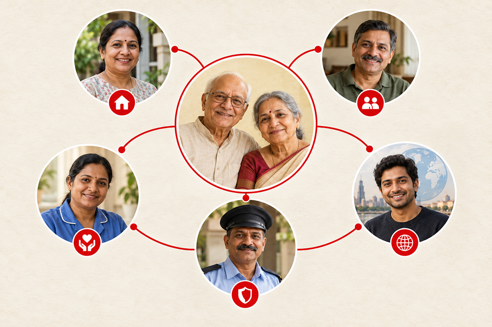
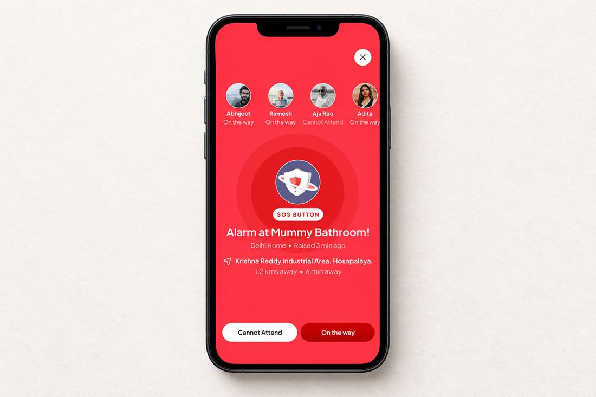

# How to Build a Nest of Trusted People for Your Parents in India While You Are Abroad

A missed call can make your stomach drop. A message that your mother felt dizzy, or that your father slipped in the bathroom, can make you wish you were minutes away instead of a flight away. When you live abroad, distance means more than fewer visits. It means that when something goes wrong, you are often the last to know and the least able to act. You can’t always be there. But your parents don’t have to depend on luck, or on one person picking up the phone at the right moment.
The most practical thing you can do is build a Nest around them.

## What is an EyEagle Nest?

An EyEagle Nest is the group of people your parents trust, connected through the <a href="https://eyeagle.ai/app" style="color:#CC0000; text-decoration:none;">Nest app</a>, who are alerted together when an EyEagle SOS is raised. It is not a list of numbers saved in your phone. It is family, neighbours, caregivers and other trusted responders, each with a part to play, all seeing the same alert.

When the SOS is pressed, every connected Nest member receives the alert and its location in the app, wherever they are. Nest then shows the whole group who has seen the alert, who has accepted it, who is on the way and who can’t attend.

That last part matters more than it sounds. In an emergency, the hardest question is rarely “who got the message?” It is “who has taken responsibility?” A Nest answers it for everyone, including you.

## Why One Emergency Contact Is Not Enough

Most families already have some arrangement: a neighbour with a spare key, a relative in the same city, a caregiver, a daily phone call. Each of these helps. The weakness is that responsibility is usually unspoken. When your mother doesn’t answer, you call the neighbour, who is out. You try a cousin, who is in a meeting. Meanwhile nobody knows who has actually taken charge, and you are piecing it together from thousands of miles away.

The problem is rarely that nobody cares. It is that nobody has been clearly asked to own it. A Nest turns “someone will probably go” into “Rakesh has accepted and is on the way.”

## Start With the People Your Parents Trust

Build the Nest with your parents, not around them. Ask who they would be comfortable calling in a difficult moment. Who lives nearby? Who visits regularly? Who would they let into the house if they couldn’t reach the door? Who would they trust to go with them to a hospital?

The answers are often a long-standing neighbour, a relative in the same city, a close family friend, a caregiver, or a security guard in their building. A neighbour who has known your family for fifteen years may be worth more in an emergency than a relative added only because of an address. Your parents should know why each person is in the Nest and be comfortable with it. The Nest exists to support their independence, not replace it.

### Give Everyone a Role They Can Actually Handle

Once you know who is in, decide what each person can realistically do.

- The neighbour two streets away may be the first to reach the door.
- A relative in the same city may handle the hospital and paperwork.
- A caregiver or guard may be the person who hears the alarm first.
- You may coordinate from abroad: calling the hospital, informing siblings, keeping everyone updated.

The most important rule is not to depend on one person. People travel, phones get left behind and life happens. Aim for at least two or three people who can respond, plus trusted backup contacts, so that if one person can’t attend, the alert still reaches someone who can. Nest alerts everyone together, so nothing hinges on a single phone ringing at the right moment.

### Decide What Happens Before It Happens

An emergency is the worst time to work out who should be called. Imagine your parent falls in the bathroom while you are at work in another country. You call and there is no answer. Who goes? Does that person know the flat number, how to get in, which hospital your parent prefers, where the insurance papers are?

Settle these questions in advance. Agree who goes first, who calls you, and which hospital to head for. <a href="https://eyeagle.ai/" style="color:#CC0000; text-decoration:none;">EyEagle</a> helps families prepare a response plan covering contacts, home access and hospital preferences. It also helps map the hospitals near your parents’ home, so your family decides in advance which one to go to for which kind of emergency.

You can also keep health conditions, allergies, medications, insurance details and documents such as Aadhaar and medical records together in Nest. When a hospital asks for them in a hurry, they are already in one place.

The aim is not to rehearse the worst every day. It is to make sure nobody has to stop and ask, “What do we do now?”

## What Happens When Your Parent Presses the Button

Knowing the sequence helps everyone stay calm when it matters.

1. **The alarm sounds at home.** The Home Hub sounds its alarm outside the bathroom, so family, neighbours, staff or guards nearby can act.

2. **Your Nest is alerted.** Every connected member receives the alert and location in the app. With the right permissions enabled, Nest can deliver critical alerts even when a phone is on Silent or Do Not Disturb.

3. **EyEagle is alerted too.** The EyEagle Response Team is notified alongside your Nest, ready to step in if needed.

4. **Your Nest responds.** Members accept the alert, mark that they are on the way, or say they can’t attend, and everyone sees it.

5. **If the Nest can’t respond, EyEagle takes ownership.** For eligible memberships, the Response Team confirms the situation and location and coordinates the appropriate emergency service. It stays with the incident until your parent is handed over to the hospital or a trusted person takes over.

6. **You stay informed.** Your family gets updates on the response, where your parent is going and what happens next.

The bathroom door adds another layer. If the Door Lock Sensor detects that the door has stayed locked for too long, the Alert Unit alerts trusted people automatically, even if nobody has pressed anything.

## Why the Bathroom Comes First

<a href="https://eyeagle.ai/blogs/falls-kill-more-seniors-than-you-think" style="color:#CC0000; text-decoration:none;">The bathroom is where many serious falls happen</a>, and it is where your parents are most alone. It is private, often locked, and a problem can go unnoticed for a long time. That is why the EyEagle system begins there. The Alert Unit gives your parent a simple way to call for help without reaching for a phone. Behind that simplicity are details that matter to families:

- **Nothing to wear or charge.** Their routine stays uninterrupted.
- **No cameras or microphones.** Their privacy stays private.
- **No home Wi-Fi needed.** The system has built-in 4G connectivity, so an SOS doesn’t depend on the home network.
- **No smartphone needed.** Your parents press the button. The app is for Nest members.

For families who also want to reduce risk, EyEagle can assess the bathroom, recommend practical changes and install the improvements you choose.

## What If Nobody Nearby Can Go?

This is the hardest question, and a good plan faces it directly. If no trustworthy person can physically reach your parent, faster awareness alone doesn’t make them safer. So don’t build a Nest from one or two names. Add neighbours, building staff, nearby relatives and a regular caregiver. EyEagle also sets up caregivers and guards so they understand the alarm and what to do, and the Response Team helps coordinate local help and emergency transport.

It is worth being honest about the limits. Coordination depends on partner availability and location coverage, and ambulance arrival times can’t be guaranteed. That is exactly why people on the ground matter. If you aren’t sure who could go, treat that as the first finding of your planning, not a reason to put it off. Often the answer is a conversation your parents have been meaning to have with a neighbour for years.

### Keep the Nest Ready

A Nest only works if it is current. People move, numbers change and your parents’ needs change too. Test it. Ask yourself: “If Mum pressed the button tonight while I was asleep, who would know, who would go, and how would I find out?” EyEagle installs and tests the complete alert path before handover, and membership includes regular readiness checks, periodic confirmation of trusted and backup contacts, and an annual safety review as your parents’ needs change.

### Support, Not Surveillance

There is a real difference between a safety network and feeling watched. Your parents should still feel that the home is theirs and that they are in charge of their own routine. The Nest doesn’t put a camera in the bathroom or ask your parents to change how they live. It sits quietly in the background until they need help, and then makes sure the right people know.

## You May Be Far Away. Your Parents Don’t Have to Be Alone.

You can’t promise to always be at their door. But you can make sure that when your parents need help, they can ask for it with one press, the people they trust are told straight away, and someone has taken responsibility, with a response team behind them if the Nest can’t respond.

Get EyEagle membership today and add a layer of safety Nest for your parents today.

<a href="https://eyeagle.ai/" style="color:#CC0000; text-decoration:none;">Check whether EyEagle is available for your parents’ home</a>
