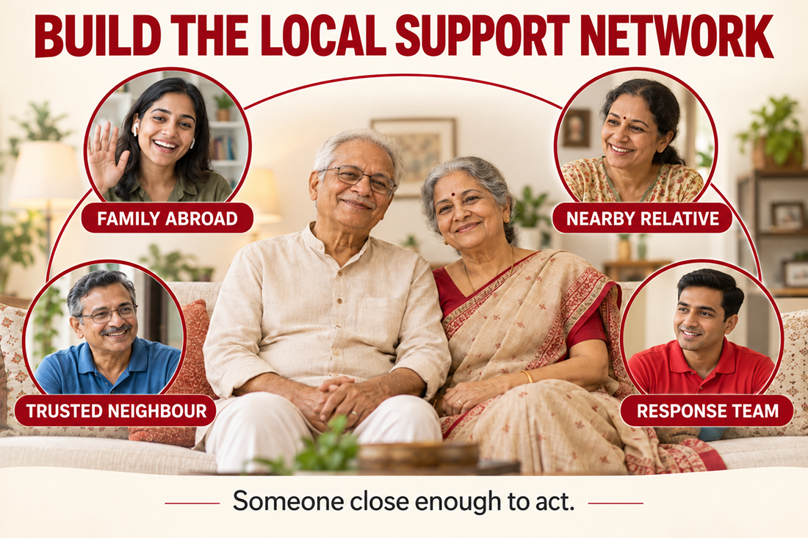
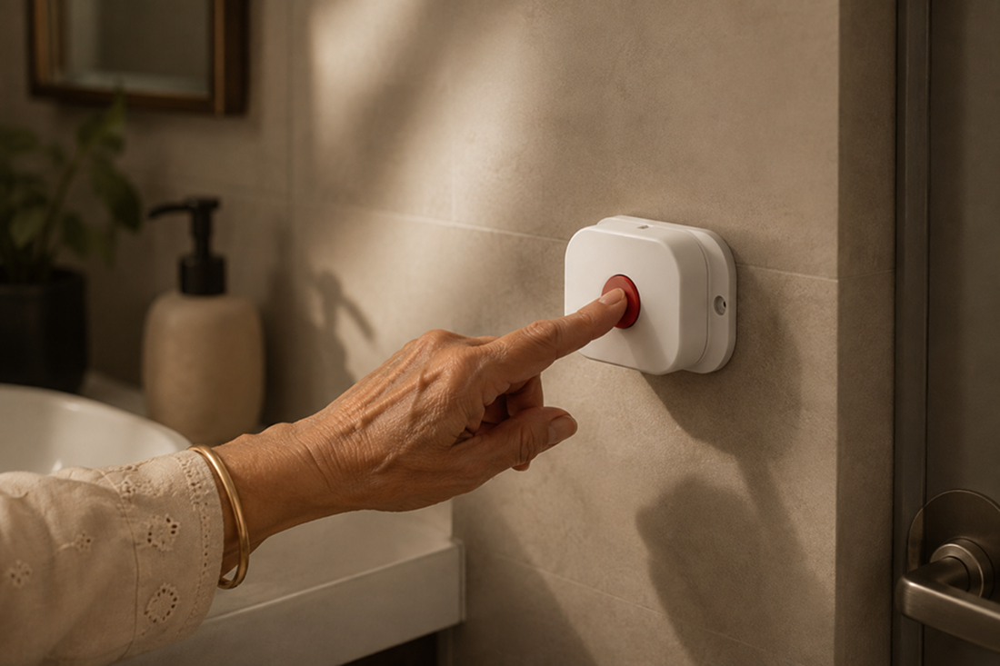
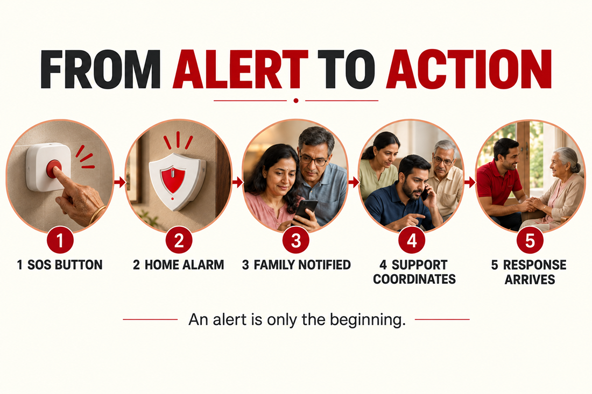

# Living Abroad, Parents in India: A Complete Safety Setup Guide for the First Trip Home

Everyone thinks moving abroad is fun. No one sees the invisible price you have to pay. They don’t see the tension gnawing at you about your parents' safety, as you leave them behind. Talking over the phone or video calling them doesn't stop you from wondering if everything is fine back home. These things aren’t as comforting when you are sitting thousands of kilometers away, instead of being a call away. If your parents live alone or as a couple back home, it's time to review their everyday safety setup. Your first trip home after a long break is the perfect time for it.

The goal is to set up a safety system for parents living alone. It is not about stripping away their independence, setting up constant surveillance, or turning home into a hospital. It is about analysing the day-to-day risk factors and creating a reliable support system. A quick response plan that executes perfectly even when you are not physically present to help them.

Many families, without realising it, overlook small things. It could be a loose floor mat, a poorly lit staircase, or a forgotten emergency contact, which can become a problem when no one is there to help. Your first trip home is an opportunity to make your parents aware and introduce preventive net and measures calmly.

## Why a safety setup for parents living alone matters

According to the <a href="https://www.cdc.gov/falls/prevention/index.html?" style="color:#CC0000; text-decoration:none;">Centers for Disease Control and Prevention (CDC)</a>, 1 in 4 adults aged 65 or older report falling every year. A person ageing doesn't automatically indicate that they need constant supervision. They can stay active and independent for several years if we analyse their surroundings correctly.

<a href="https://www.who.int/news-room/fact-sheets/detail/falls?" style="color:#CC0000; text-decoration:none;">The World Health Organization</a> identifies falls as a major global health concern. Adults over 60 experience the greatest number of fatal falls, and they are severe enough to require medical attention. This does not mean that your parents should be treated as fragile. Instead, it suggests that a few practical changes can make their home easier and safer to navigate.
You live far away from your parents and visit once a year or once every two years because of financial constraints, job requirements, or other reasons. And every time you talk to your parents in India raises the same quiet question: <a href="https://eyeagle.ai/blogs/caring-for-elderly-parents-while-working-abroad" style="color:#CC0000; text-decoration:none;">Are they actually safe when I am not here</a>? Then, a safety setup for parents living alone can help answer that question without making your parents feel watched, restricted or dependent. An on-ground response team is necessary for people whose parents live alone in metro cities.

Think of your visit as an opportunity to ask:

- What happens if no one comes to aid?
- What could make the home safer?
- What happens if one parent needs help and the other is not around?
- Who can reach the house quickly?
- Can your parents easily raise an alert?
- Who receives that alert?
- What happens after someone is notified?
- What can you do from abroad if you cannot reach them immediately?

Having answers to these questions before you fly back can make the distance easier for everyone.

## Start your safety setup for parents living alone with a home walkthrough

Once you're back home, don't immediately jump to moving things around, buying gadgets, adding emergency contacts, or finding technology that prevents falls. Start by learning what is causing inconvenience for them. This distinction will help you learn their needs.

### Check the living areas.

Look at the paths between the bedroom, living room, kitchen and bathroom. Are these pathways used frequently? Are the floors clutter-free? Is there anything that can become a trip hazard or can cause obstruction? <a href="https://www.cdc.gov/falls/prevention/index.html?" style="color:#CC0000; text-decoration:none;">The CDC recommends removing trip hazards, keeping floors clutter-free, and improving lighting to make homes safer for older adults.</a>

### Review the bathroom

You come home after a long time and start wondering if bathrooms are safe for your parents. Bathrooms have slippery floors, hard surfaces, limited space, and water. A question eats at you: What if something happens to them inside the bathroom? Who will come to help them? Have you taken any fall preventive measures? These questions take your safety setup beyond simply removing hazards. It becomes about finding a solution that can reach them when you cannot, even in the middle of the night.

### Check stairs and balconies

If your parents live in a home with stairs, check for hazards. <a href="https://www.cdc.gov/falls/prevention/index.html?" style="color:#CC0000; text-decoration:none;">The CDC recommends handrails on both sides of staircases as one home-safety measure for older adults.</a>

## Create a clear emergency contact network

What happens when you call your parents in India several times, and they don’t pick up? What happens when they don’t call you back? They might be busy, but part of you worries something might have happened to them with no one to help. When you live abroad, communicating might not be as easy. You might be busy, travelling, or asleep, so you cannot assume calling will always be enough.

On your first trip home create a simple network that can reach them in times of need. Identify people who can reach them, including a sibling living nearby, a trusted neighbour, a cousin, a close family friend, an adult niece/nephew, building security, or even a professional support service. Their most important role is simply being close enough to check on your parents when needed.

## Make sure your parents can reach help without searching for a device

During a fall or sudden emergency, finding a phone or unlocking a device may be difficult. Smartphones can be left in another room, while smartwatches and SOS pendants need to be worn and kept charged. In the bathroom, where people rarely carry their phones, reaching a device may be especially difficult after a slip. When building a safety setup for parents living alone, consider more than how an alert is triggered. Assess how easy the system is to use, whether it remains accessible, its power and connectivity requirements, and what happens after an alert is raised. A fixed SOS button provides a dedicated way to call for help in a specific area of the home, such as the bathroom. The key question is: who responds if your parents cannot reach their phone or no one acknowledges the alert?

## Complete safety setup for parents living alone with EyEagle

EyEagle can be that answer to all the above queries. <a href="https://eyeagle.ai/app" style="color:#CC0000; text-decoration:none;">EyEagle is a dedicated SOS system</a> that can be added to your parents’ home without requiring them to wear or constantly charge a device.

It has no cameras, helping preserve their privacy while supporting independent living. The system also includes a bathroom alert unit that can flag when the bathroom door remains locked for a configured period. This provides an additional way to identify a potential concern when someone may need assistance but has not pressed the SOS button.

The response process is straightforward:

- EyEagle Response comes to aid

  When an alarm is pressed, the 24x7 on-ground emergency response team from EyEagle de-escalates the situation. **EyEagle Response team contacts trusted family members and local support.** When required, the team can coordinate ambulance service and other emergency support. This is particularly relevant when you are living thousand miles away and cannot come to help your parents at one call.

Steps to raise an alarm:

1. **Press the SOS button:** Your parent deliberately presses the installed button when they need help.
2. **Sound the in-home alarm:** A loud alarm alerts people nearby, such as family members, neighbours or security personnel.
3. **Notify trusted family:** EyEagle Nest sends an SOS notification to selected family members, helping them begin coordinating support, even when they live abroad.

For families living thousands of miles away, this final step matters. An alert is only the beginning; having a defined process for following up can help bridge the distance between your parents and the people who can assist them.

When evaluating any SOS system, look beyond the alarm itself. Consider accessibility, reliability, privacy and the support available after an alert. **EyEagle combines a fixed bathroom SOS button, a configured long-duration bathroom-door alert, family notifications and a pathway to human response support helping your parents maintain their independence while giving your family a clearer way to coordinate help.**

## EyEagle as one quiet layer of protection

EyEagle provides not only the SOS alarm system with a 24x7 response team, but it also provides <a href="https://eyeagle.ai/" style="color:#CC0000; text-decoration:none;">fall prevention for the elderly.</a> EyEagle also provides the assessment and installation of these fall preventive measures in your bathroom. The bathroom safety kit includes:

- **Wall grab bars:** Light support points around the bathroom. It is placed near showers, doors and bucket areas.
- **Toilet support rail:** This is a heavy-duty sit–stand support beside the toilet seat for confident movement.
- **Anti-slip mat:** They are grippy and placed around the draining surface where you stand in the wettest parts of the bathroom.
- **Anti-slip tape:** These are thin, transparent strips that add traction on narrow, slippery paths.

## Talk about safety without taking away independence

Your first trip home is an opportunity to make your parents’ home safer without changing how they live. discuss practical improvements and explain how these measures can make everyday life easier and help accessible. EyEagle adds another layer of protection without compromising their independence or privacy. There are no cameras, no wearable devices to remember, and no constant charging. Its installed SOS system, and bathroom lock alert system provides a simple way to raise an alarm. Then it notifies trusted family through Nest, and connects eligible unresolved alerts to EyEagle Response for support coordinating the next step. Involve your parents in the decisions. Ask what would make them feel safer. The goal is to help them continue living independently, with a clearer path to support when they need it.

## Why a connected response matters for families living abroad

Distance changes the way families respond to emergencies. If you live in the same city as your parents, you can reach them quickly. But if you live continents away, in another country, your response depends on communication and coordination. If you receive a call about an emergency and don’t have a connected system, then you might panic and start calling relatives or loved ones randomly. The emergency response team saves you from that panic.

EyEagle brings together:

- An installed SOS button
- A loud in-home alarm
- Trusted family notification through Nest
- A defined response pathway
- EyEagle Response for eligible unresolved alerts

That makes it one layer of a wider family safety plan. It does not replace local contacts, emergency services, or home safety measures. It connects them.

## Do Not Wait Until There Is a Problem to Start Preparing

You have a life overseas, and your parents have a life here. Do not need to wait for a worrying incident to start safety planning for them back home. Use your first trip home to make a few practical changes without any delays.

Walk through the house. Review the bathroom. Build a local support network. Update emergency contacts. Agree on a communication routine. Talk to your parents about what they are comfortable with. And put a clear response system in place.

<a href="https://eyeagle.ai/store" style="color:#CC0000; text-decoration:none;">Bring an additional protective layer with EyEagle.</a> It brings prevention, detection, alarm, notification and action into one framework. You cannot always be physically present. But you can help make sure your parents are not left without a plan.

## Your first trip home is the perfect time to build a safety setup and put it in action.

Your first trip home is perfect to put a practical safety plan in place for your parents. Start with a clutter-free home, clear walkways, appropriate handrails and grab bars, and other measures that reduce everyday risks. Identify trusted local contacts, establish a regular check-in routine without hindering privacy, and make sure everyone knows whom to contact when help is needed.

But prevention should go beyond making the home safer. What happens if your parents need help and you are thousands of kilometres away?

This is where EyEagle adds an important layer of protection. Its installed SOS system raises a loud alarm inside the home, notifies trusted family through Nest, and connects eligible unresolved alerts to EyEagle Response. This creates a defined path from the moment an SOS is pressed to the people who can coordinate the next step. If the bathroom stays locked for a long time, the alert unit notifies trusted people automatically. When an alert remains unresolved, eligible EyEagle Response support can help coordinate the appropriate next step, according to the service setup.

Give your parents the confidence to live independently, without compromising their privacy. Combine practical home-safety measures, trusted local support with <a href="https://eyeagle.ai/app" style="color:#CC0000; text-decoration:none;">EyEagle’s connected SOS system</a> and emergency response support. Make EyEagle part of your parents’ safety setup before your next flight back. Explore how EyEagle can help connect your parents to trusted family and eligible EyEagle Response support when it matters most.

## Disclaimer

This article is intended for general safety and awareness purposes only. It does not provide medical advice, diagnosis or treatment recommendations. Individual circumstances and safety needs can vary.
