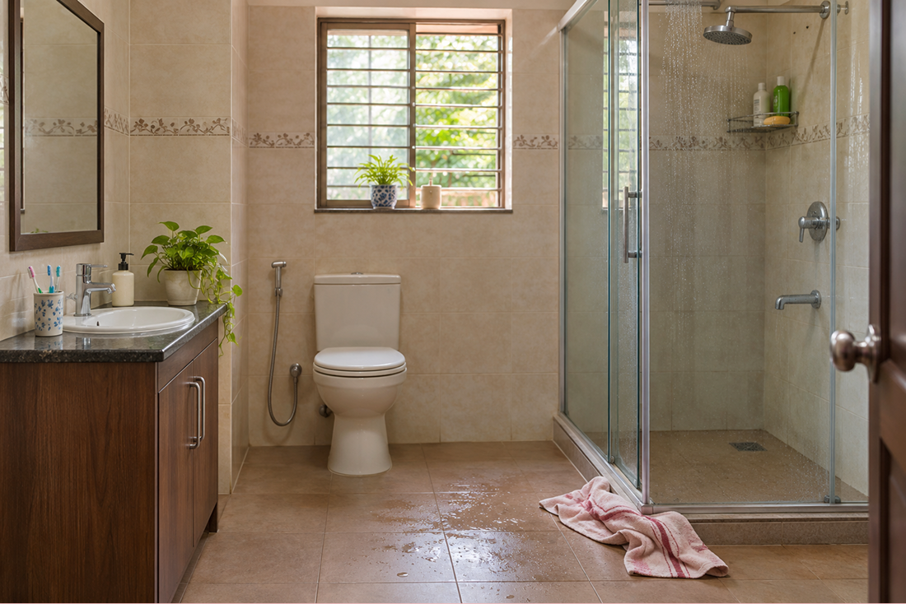
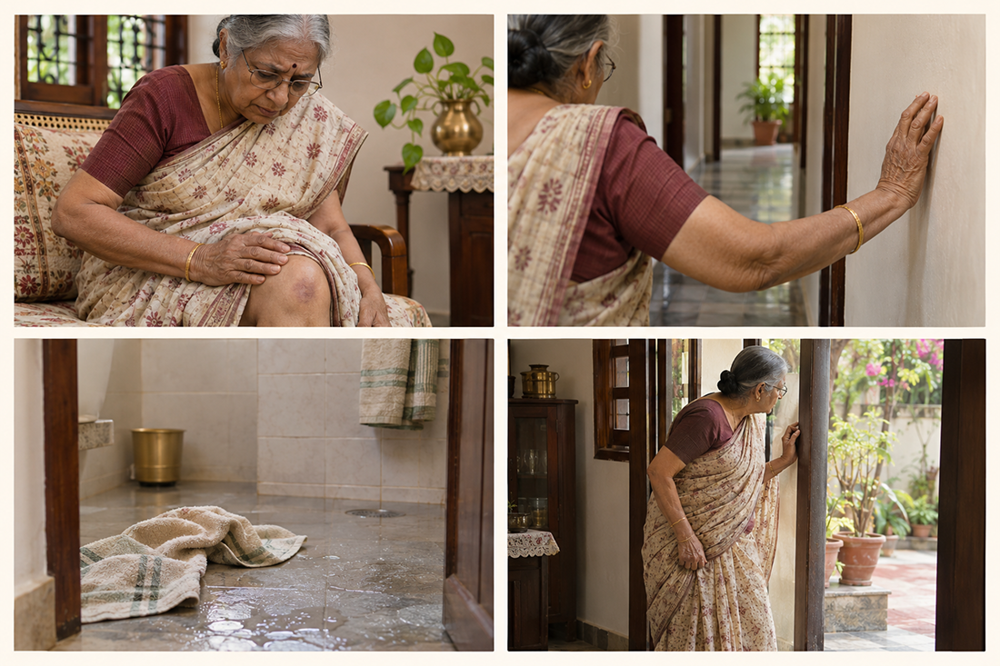
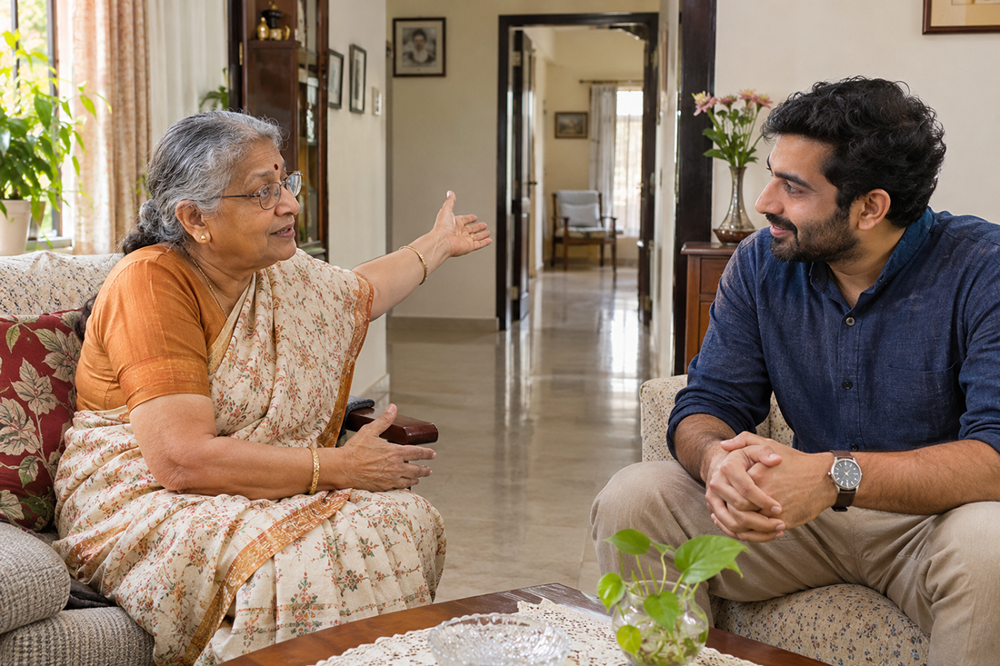
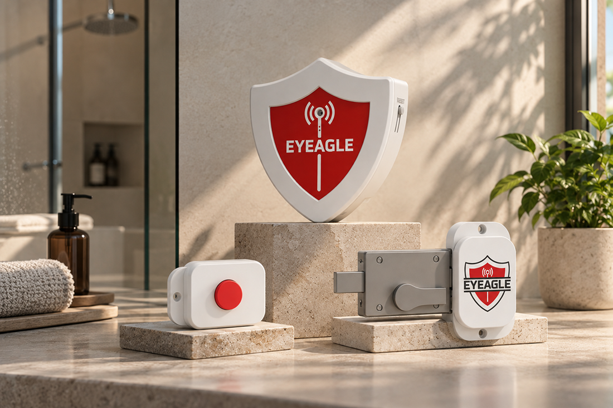

# What Your Parents Aren’t Telling You About Small Falls and Near-Misses

“Everything’s fine.” If your parents live in another city or country, you may hear those words often. You call on a Sunday evening, ask about their week, talk about work, dinner, the neighbours and the weather. Just before you hang up, your mother casually mentions, “I slipped a little in the bathroom last week. Nothing happened.” Before you can ask what happened, she has already moved on. You ask if she is hurt. She says no. The conversation continues. It may sound like a small moment. And if there was no injury, it may feel easy to dismiss. But small falls and near-misses can be useful signals. They can point to something in the home that needs attention, a change in balance or confidence, or simply a gap in the family's safety plan.

The important thing is not to treat one small incident as proof that your parents can no longer live independently. It is to notice the signal, understand what happened, and decide together whether anything needs to change.

## Why Parents Don’t Always Tell You About Small Falls

Your parents may not mention every slip, stumble, or near-miss for a very simple reason: they do not want you to worry. There may be something else underneath it, too. Independence matters. For a parent who has spent decades managing their own home and making their own decisions, saying “I fell” can feel like opening the door to a much bigger conversation. What if their children start asking whether they should still live alone? What if everyone starts suggesting that they move closer, have someone stay with them, or stop doing certain things around the house?

That fear can make a small incident feel bigger than it actually is.

Sometimes a parent may also genuinely believe that a near-miss is not worth mentioning. They may say, “It was nothing,” because they got back up, finished what they were doing, and carried on with their day.

So when a parent doesn't immediately tell you about a small fall, it is worth remembering that this is not necessarily about hiding something from you. It may simply be about dignity, independence, and not wanting their children to worry. That is why your response matters.

## Small Falls Are Signals, Not Verdicts

A small fall or near-miss does not automatically mean that your parents are unsafe at home. Instead, think of it as a reason to look a little closer. Was the bathroom floor wet? Was there something to hold while getting up? Was the lighting poor? Was there a loose mat or towel on the floor? Did your parent feel dizzy or unsteady?

There may be a simple environmental change that can reduce the risk of another incident. The <a href="https://www.who.int/publications/i/item/978924002191-4" style="color:#CC0000; text-decoration:none;">World Health Organization</a> recommends measures such as home assessment and modifications, along with strength, balance, and functional training, as part of fall prevention for older people. WHO also identifies unsafe environments as an important fall risk.

There is another part of the conversation that families sometimes overlook: <a href="https://eyeagle.ai/blogs/the-critical-60-minutes-after-a-fall" style="color:#CC0000; text-decoration:none;">what happens after a fall or near-miss.</a> A parent who becomes afraid of falling again may start changing their routine. They may walk less, avoid stairs, stop going out as often, or become more cautious about everyday activities. WHO's falls-prevention material recognises fear of falling as an important issue among older people, including concerns about injury and losing independence. That does not mean every parent who has a near-miss will become fearful. It simply means that the physical incident is not always the only thing worth noticing.

## Why the Bathroom Deserves Special Attention

For many families, the bathroom is one of the last places they think about when making a home safer. It is also one of the places where several potential hazards can exist together. There may be wet or slippery flooring, limited space to move, changes in floor level, and the need to sit down and stand up from a low toilet. For someone using an Indian-style toilet, getting down and back up may require additional balance and strength.

WHO guidance specifically notes that falls among older adults living independently commonly occur in and around the home, with bathrooms and stairs associated with a higher risk of injury. It also identifies slippery or uneven flooring, poor lighting, clutter, and a lack of handrails among relevant environmental risks.

There is another challenge with bathrooms: privacy.

A bathroom door can be closed or locked. If your parent is alone inside, an incident may not be noticed immediately. This concern has a personal origin. EyEagle was inspired by the loss of Smt. Savitri Devi Sharma, our beloved Naniji, after a fall in the bathroom. The experience became part of the reason why we built EyEagle around safer, more independent living for older adults.

<a href="https://eyeagle.ai/about-us" style="color:#CC0000; text-decoration:none;">Read More about our Story</a>

## Quiet Signs You Might Notice

Your parent may never tell you, “I am worried about falling.” Instead, you may notice small changes during a phone call or visit. Perhaps there is an unexplained bruise followed by, “I just bumped into something.” Perhaps bathing has become less frequent, or your parent seems to rush through the bathroom routine. Maybe you notice them holding onto walls, furniture, or door frames while moving around the house. They may also start going out less often or say, “I'm just tired,” without explaining much more. Sometimes the home itself gives you clues. A towel may be placed on the floor to provide extra grip. Mats may have been moved around. Furniture may have become part of a route through the house because it provides something to hold.

None of these signs proves that there is a serious problem. But they can be a reason to start a conversation.

## How to Talk About Falls Without Making Your Parent Feel Watched

The way you start the conversation can make all the difference. Begin with their independence, rather than their vulnerability. Instead of saying, “Are you having trouble walking?” you could ask, “Is there anywhere at home where you wish you had more support?” Instead of asking, “Why are you holding onto the wall?” you could ask, “Does that part of the house feel slippery or difficult to move through?” And instead of making the conversation about what your parent can no longer do, make it about what they want to continue doing safely. Ask about the home.

- Does the bathroom floor get slippery after a shower?
- Is there anything you wish was easier to reach?
- Do you feel comfortable getting up from the toilet?
- Is the bathroom easy to use at night?

These questions leave room for your parent to explain what they actually experience. Most importantly, let them participate in the decisions. The goal is not to turn an independent parent into someone who feels monitored. It is to create a plan that supports the way they want to live. If you have siblings, a trusted neighbour, or a relative who lives nearby, it can also help to involve them early, particularly if you live in another city or country.

## From Worry to a Simple Safety Plan

Once you've had the conversation, you don't need to change everything at once. A practical home safety plan can start with three layers: reducing risk, creating a simple way to signal for help, and deciding who responds.

### 1. Reduce Risks Around the Home

Start with the areas your parent uses every day. Grab bars can provide stable support where appropriate. Better lighting can make movement easier at night. Floor-grip solutions can help address slippery areas. Removing loose mats, clutter, or towels from walking paths can also reduce potential trip hazards.

These measures are about reducing risk. They are not about making a home “fall-proof.”

### 2. Make It Easy to Signal for Help

If something happens in the bathroom, reaching for a phone may not always be practical. A manual SOS button that can be reached from the relevant area gives your parent another way to actively signal that they need help. The system should be simple enough for them to understand and comfortable enough for them to use.

### 3. Decide What Happens After the Signal

This is often the missing part of a family safety plan.  
Who receives the alert first?  
Who is close enough to reach the home?  
Who checks on your parent?  
What happens if the first person does not respond?

Having those answers in advance can make an emergency less confusing for everyone involved.

### 4. A Simple Checklist for Your Next Call

Ask your parent:

- Have you had any slips, stumbles, or near-misses recently?
- Is there any area of the house where you feel less steady?
- Does the bathroom floor become slippery?
- Is there something sturdy to hold near the toilet or bathing area?
- Is the bathroom well lit at night?
- If you needed help in the bathroom, could you reach your phone?
- Who would you want contacted first if you needed help?
- Does everyone involved know what they are expected to do?

It does not have to be an interrogation. It can simply be another part of your regular conversation.

## Where EyEagle Fits Into the Plan

For families living away from their parents, the challenge is not only reducing risks at home. It is also knowing what happens if a parent needs help when nobody is nearby. That is the gap we built EyEagle for. It is an emergency response system for parents living alone, 24x7, 365 days. It brings together a safer home, a simple way to call for help, and the people your parents trust.

The <a href="https://eyeagle.ai/store" style="color:#CC0000; text-decoration:none;">EyEagle Device</a> includes:

- Alert Unit with SOS button and Door Lock Sensor
- Home Hub with Alarm
- Professional installation and testing
- Nest app for family and trusted contacts

Here is how the pieces work together:

- **Calling for help:** Your parent can press the SOS button on the Alert Unit without reaching for a phone. If the bathroom door stays locked for too long, the Door Lock Sensor alerts trusted people automatically, without a press.

- **At home:** The Home Hub sounds its alarm outside the bathroom, so family, neighbours, staff or guards nearby can act.

- **Across distance:** Every member of your Nest receives the alert and its location in the **EyEagle Nest app**. They can also see who has seen the alert and who is responding to it.

- **If no one responds:** The EyEagle **Response Team**, available 24/7, is notified alongside your Nest. If no one responds, the team reviews the unresolved alert, follows your family’s response plan and coordinates further help when needed.

EyEagle is meant to add a layer of safety without asking your parents to change how they live. There are no cameras or microphones, and there is nothing to wear or charge. The system uses built-in 4G, so an SOS does not depend on home Wi-Fi, and it has backup power for outages.

For the home itself, <a href="https://eyeagle.ai/" style="color:#CC0000; text-decoration:none;">EyEagle's Bathroom Protection Kit</a> includes safety hardware such as grab bars and anti-slip support, selected and installed based on the bathroom's specific risk points rather than following one fixed setup.

The important idea is simple: **EyEagle is more than an SOS button. It's a plan for what happens after the signal.**

## The Next Time Your Parent Says, “I Slipped a Little”

Think back to that Sunday evening call. Your mother says, “I slipped a little in the bathroom last week. Nothing happened.” This time, instead of brushing past it or immediately becoming alarmed, you can ask a few simple questions.

- Are you okay?
- What happened?
- Was the floor wet?
- Was there anything to hold?

And then: Can we look at that area together and see if there is anything that would make it easier? That conversation does not have to be about taking away independence. It can be about protecting it. Your parent remains the person making decisions about their home and their life. You simply become better prepared to support those decisions from wherever you are. Because sometimes the most important safety conversation begins with something that sounds like nothing: I slipped a little.

**Talk to the EyEagle team today to explore a practical home and bathroom safety plan for your parents.**
